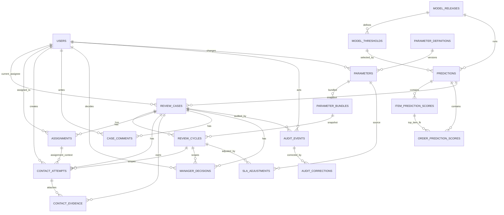

# ERD — As-built

## Bất biến vật lý đáng chú ý

- `review_cases.order_id` unique: một workflow case cho mỗi order.
- `(review_cycles.case_id,cycle_no)` unique.
- Một assignment active/case qua partial unique index `released_at IS NULL`.
- Parameter, audit, attempts, evidence, comments, decisions và corrections là
  append-only bằng trigger và/hoặc DB grants.
- Prediction score rows và model releases immutable.
- Một prediction snapshot ACTIVE tại một thời điểm.
- Review case không được đổi order/prediction/aggregation/original queue snapshot.
- Queue seed audit phải dùng actor SYSTEM và event type QUEUE_SEED.

## Lưu ý legacy

`contact_attempts` giữ cả bộ cột P7 (`channel`, `status`, `outcome`) và bộ cột API
v0.5 bổ sung (`cycle_id`, `contact_result`, `note`, `next_contact_date`,
`evidence_ref`). Đây là schema tương thích ngược, chưa được chuẩn hóa thành một bộ
cột duy nhất.
