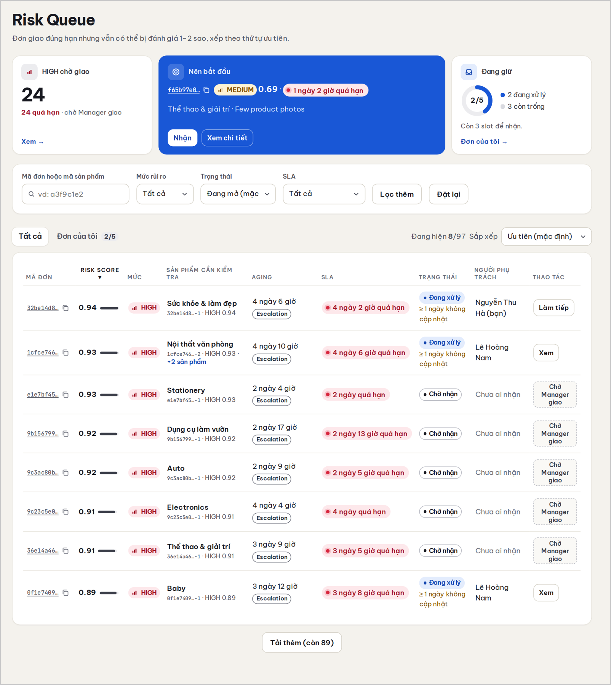
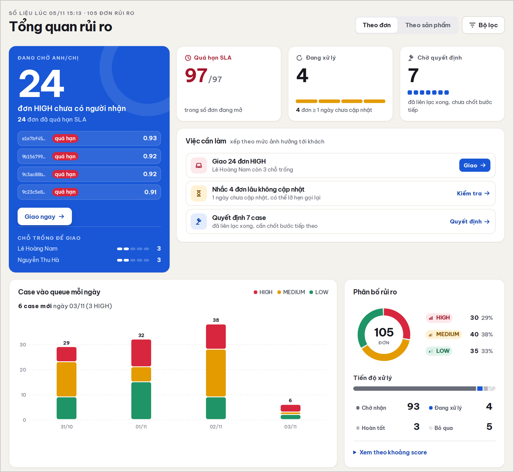
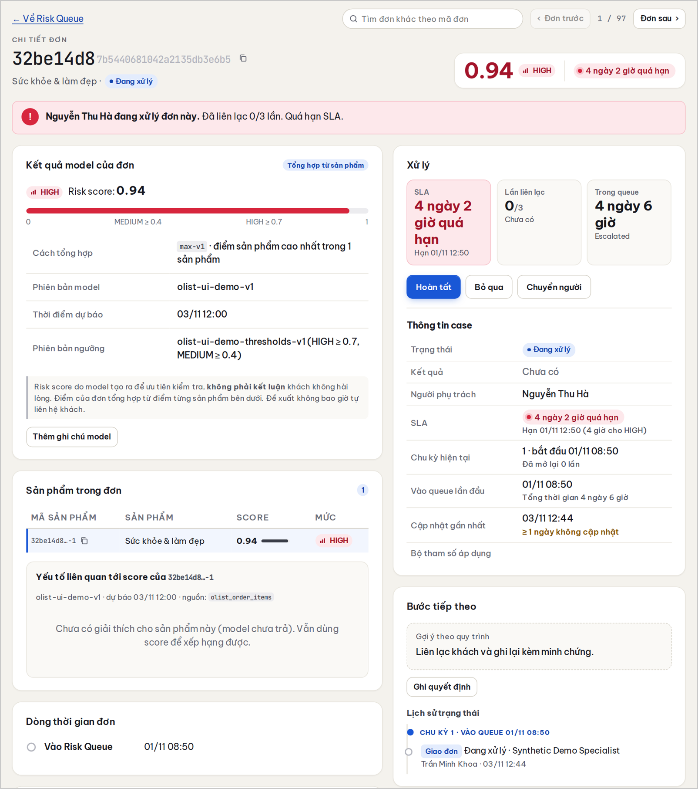
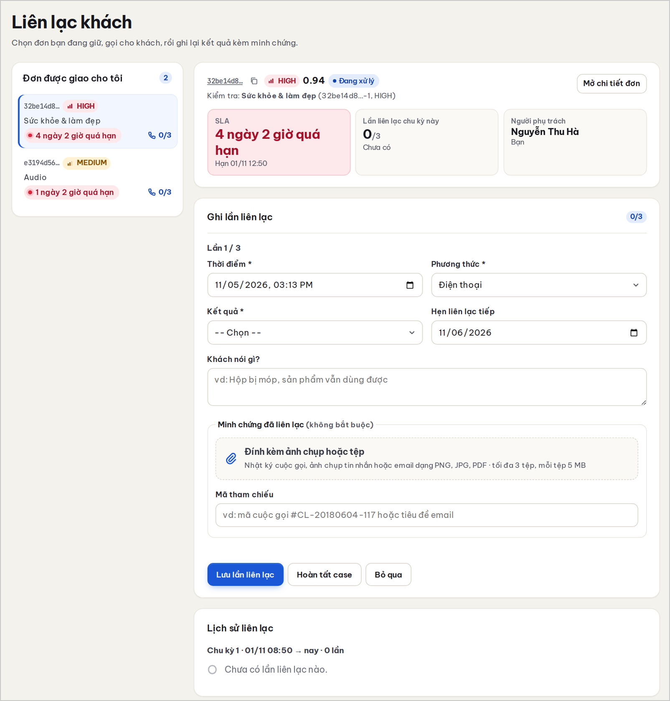
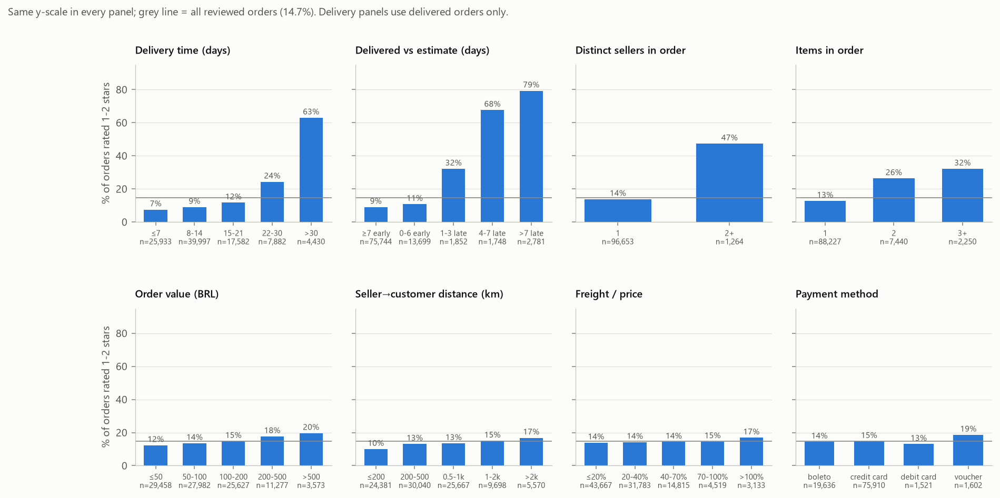
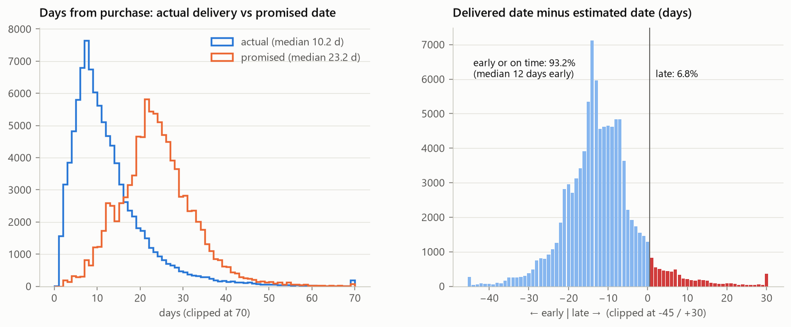
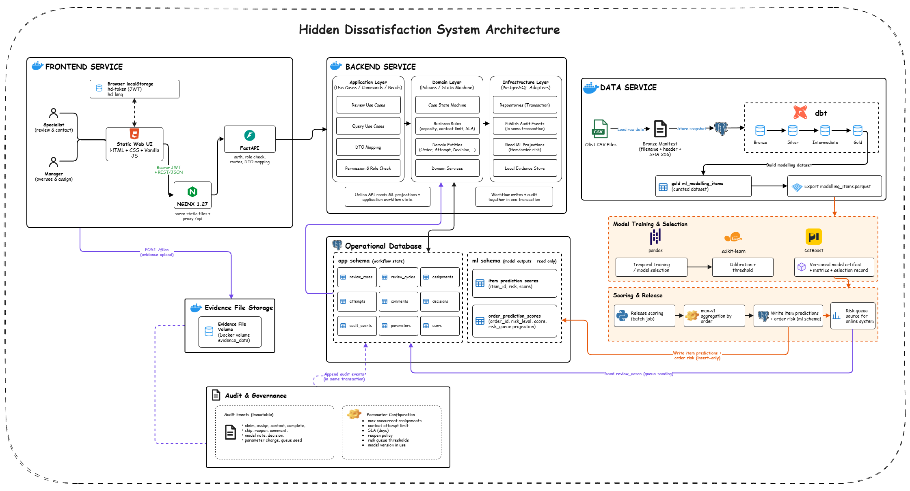

# Hidden Dissatisfaction

**Predicting 1–2★ reviews on orders that were delivered on time, and turning the scores into a prioritized case-handling workflow.**

[](https://github.com/UEL-WEB-ML/Hidden-Dissatisfaction/actions/workflows/quality.yml)

-lightgrey)


Late delivery is the best-known cause of bad reviews, so operations teams watch late orders. This project looks at the remainder: orders that arrived **on time or early** and still received 1–2 stars — *hidden dissatisfaction*. There is no delivery alert for these orders, so a customer-care team learns about them only after the review is posted.

The repository contains the full path from raw data to a working tool:

- a **warehouse** (PostgreSQL + dbt, Bronze → Silver → Intermediate → Gold) built from the Olist dataset;
- an **ML pipeline** with leakage-controlled features, rolling-origin validation, calibration and a top-k priority threshold;
- a **case-handling application** (FastAPI + static web UI) with role-based access, SLA tracking and an append-only audit trail;
- the **course report** (LaTeX, Vietnamese) in [`Thesis/latex/`](Thesis/latex/main.tex).

> **Read this first.** Model results are exploratory development results, not a confirmatory estimate. The bundled demo UI shows deterministic **synthetic scores**, not production model inference. All claims are predictive/associational, never causal.

## Application

The web app puts the risk score to work: specialists claim and contact customers, managers assign HIGH-risk cases, and every change is audited. The UI is in Vietnamese.

**Risk queue** — orders ranked by priority, with SLA ageing, owner and next action.



**Risk overview** — workload, SLA breaches, daily inflow and risk-band mix.



<table>
  <tr>
    <td width="50%"><b>Order detail</b> — score, item-level context and handling history<br></td>
    <td width="50%"><b>Contact attempt</b> — evidence-backed customer contact<br></td>
  </tr>
</table>

| Role | Can do |
|---|---|
| `SPECIALIST` | View the queue, claim valid LOW/MEDIUM cases within capacity, record contact attempts |
| `MANAGER` | Assign HIGH cases, reopen cases, set decisions, review audit, change parameters |

Cases move through `PENDING → IN_PROGRESS → COMPLETED / SKIPPED`. Authorization is enforced in the API (Bearer JWT), not in the browser.

## Problem definition

| | |
|---|---|
| **Population** | Orders delivered on time or early |
| **Target** | Observed order review score of 1–2 (among reviewed orders) |
| **ML grain** | Product item (`product_item_id`) — each item inherits its order's label (a *weak label*) |
| **Split / workflow grain** | Order (`order_id`); all items of an order stay in the same split and bootstrap cluster |
| **Prediction time** | Right after delivery confirmation, before any review information |
| **Order score** | `max-v1`: the maximum item score in the order |
| **Decision use** | Rank a human review queue. No automatic customer action |

Because Olist only records reviews per order, an item score means *"this order is at risk in the context of this item"*. It does not show that the item caused the dissatisfaction.

## Key findings

**Exploratory analysis** (full details in the report):

- Late delivery dominates: **62.4%** of late orders get 1–2★ versus **9.3%** of on-time orders (6.7× lift).
- Among on-time orders, signals are weaker but real. Orders with two sellers are rated low **45.7%** of the time versus **8.7%** for single-seller orders; the rate rises from 7.5% (1 item) to 31.9% (4+ items).
- The study population has **85,420 orders** and a positive rate of **9.21%** — strongly imbalanced, so accuracy is not reported.

<table>
  <tr>
    <td width="50%"></td>
    <td width="50%"></td>
  </tr>
  <tr>
    <td align="center"><sub>Low-review rate by factor</sub></td>
    <td align="center"><sub>Delivery promise vs. reality</sub></td>
  </tr>
</table>

**Model** (Random Forest, depth 8, order-weighted, sigmoid-calibrated; 3-fold rolling-origin on the development partition; 61 features in 7 groups):

| Metric (order level, mean of 3 folds) | Retained model | Base-features model | Random baseline |
|---|---:|---:|---:|
| PR-AUC | **0.1465** | 0.1363 | ≈ 0.09 (prevalence, approx.) |
| Recall@5% | **0.1212** | – | 0.05 |
| Brier (uncalibrated) | **0.1907** | 0.2018 | – |

- The top 5% of orders captures about **2.4×** more low-review orders than random selection.
- Sigmoid calibration reduces item-level Brier from 0.2203 to 0.1049.
- The planned PR-AUC stopping target of 0.25 was **not reached**. Of nine feature-group experiments, three were retained (seller speed/volatility, order composition, product morphology) and six were rejected.
- The historical test partition was exposed during development, so these figures are not confirmatory. Confirmatory claims stay blocked until a replacement holdout is run.

## Architecture

The pipeline is split into an **offline** flow (ingest, build features, train, batch-score) and an **online** flow that only *reads* the stored score snapshot to drive the queue, assignments and handling records. Scores live in the `ml` schema; the workflow and the append-only audit log live in the `app` schema.



```text
Olist CSV → Bronze → Silver → Intermediate → Gold (ml_modelling_items) → Parquet
          → training & selection → release scoring (max-v1) → ml.* snapshots → API → Web UI
```

Code follows clean layers under [`src/hidden_dissatisfaction`](src/hidden_dissatisfaction): `domain` (pure rules, no I/O) → `application` (use cases, ports) → `infrastructure` (Postgres, joblib, parquet) → `api` (FastAPI, JWT) → `interfaces` (CLI), plus `modeling`.

### Research invariants

- Features are computable at delivery time and fitted on training data only, with strict history cutoffs.
- All items of one `order_id` stay in the same temporal split and bootstrap cluster.
- Minority-class and calibration metrics are reported: PR-AUC, Brier, Recall@5%.
- No raw data, credentials or large artifacts are committed.

## Quick start

**Prerequisites:** Docker with Compose v2, GNU Make, Git. Python 3.11 and [`uv`](https://docs.astral.sh/uv/) are needed only for local development and tests.

```bash
cp .env.example .env      # then replace the placeholder secrets
make start                # PostgreSQL + migrations + API + frontend
make demo-seed            # local review accounts and synthetic workflow fixtures
```

| Service | URL |
|---|---|
| Frontend | <http://localhost:4200> |
| API | <http://localhost:8000> |
| API readiness | <http://localhost:8000/health/ready> |

The smoke stack (`make e2e`) uses only schema and bootstrap fixtures and does not load the full Olist dataset. Demo credentials come from `.env` and the Git-ignored `data/evidence/P12-DEMO-CREDENTIALS.env`. Stop with `make stop` (keeps volumes). Do not run `docker compose down -v` unless you intend a full local data reset.

## Development

```bash
uv sync --frozen --extra db --extra api --extra ml --extra notebook --extra dev
uv run ruff check .
uv run black --check .
uv run mypy src tests
uv run pytest --cov=hidden_dissatisfaction --cov-report=term-missing
```

`domain` and `application` must keep **100% test coverage**. The CLI is `hidden-dissatisfaction`.

### Data and ML workflows (opt-in)

API startup never ingests the dataset. Download the nine Olist CSVs only for warehouse or modelling work:

```bash
kaggle datasets download -d olistbr/brazilian-ecommerce -p data/raw/olist --unzip
make bootstrap && make bronze-manifest && make ingest
DBT_SOURCE_RUN_ID=<completed-run-uuid> make warehouse
TRAIN_COMMAND=... make train
SCORE_COMMAND=... make score
```

The run UUID must identify exactly one `COMPLETE` row in `bronze.ingestion_runs`. Before promoting any modelling dataset, run the release gate against the complete warehouse:

```bash
DBT_USER=... DBT_PASSWORD=... DBT_SOURCE_RUN_ID=<uuid> make p4-release-verify
```

## Repository layout

```text
.
├── src/hidden_dissatisfaction/   # Python package (domain, application, infrastructure, api, interfaces, modeling)
├── dbt/                          # Silver / Intermediate / Gold models and data tests
├── frontend/prototype/           # Delivered static web UI (nginx)
├── infra/                        # API/jobs images and PostgreSQL migrations
├── configs/  scripts/  tests/    # Experiment config, helper scripts, test suite
├── BA/                           # As-built BRD, FRD, API contract, ERD, traceability
├── notebooks/                    # EDA notebooks and figures
├── Thesis/latex/                 # Course report (LaTeX, Vietnamese)
├── web/                          # Web-course report, prototype and diagrams
└── compose.yaml  .env.example  pyproject.toml
```

## Documentation

| Topic | Where |
|---|---|
| As-built product contract (BRD, FRD, API, ERD, data dictionary, traceability) | [`BA/README.md`](BA/README.md) |
| Report (Vietnamese) | [`Thesis/latex/main.tex`](Thesis/latex/main.tex) — build with `cd Thesis/latex && latexmk -pdf main.tex` (needs `biber`) |

## Limitations

- **Weak labels:** reviews are per order; item scores are not causal attributions.
- **Selection bias:** only customers who wrote a review are observed, so the model estimates *observed* dissatisfaction, not that of all customers.
- **Exploratory results:** the historical test partition was exposed during development.
- **Demo scores:** the UI uses deterministic fixtures (`olist-ui-demo-v1`), not the retained model.
- **Batch only:** no online learning, automatic retraining or automatic promotion.

## Contributing

Read [`CONTRIBUTING.md`](CONTRIBUTING.md) first. Never commit `.env`, raw Olist CSVs, credentials, evidence uploads or unreviewed experiment artifacts.

## Data and attribution

Built on the public [Olist Brazilian E-Commerce dataset](https://www.kaggle.com/datasets/olistbr/brazilian-ecommerce) (Kaggle). Course project, Faculty of Information Systems; see the report for authors and references.
