# Lý thuyết triển khai Machine Learning end-to-end cho bài toán bất mãn ẩn trên Olist

## Tóm tắt

Tài liệu này đặc tả một hệ thống học máy end-to-end để nhận diện **bất mãn ẩn**: product item thuộc đơn hàng đã giao đúng hoặc sớm hơn ngày dự kiến nhưng đơn vẫn nhận đánh giá 1 hoặc 2 sao. Hệ thống chấm điểm ở cấp product item ngay sau khi ghi nhận giao hàng và trước khi đánh giá được tạo, rồi tổng hợp lên order bằng `max-v1`. Đầu ra là điểm rủi ro item, điểm order đã tổng hợp và một danh sách order ưu tiên cho con người xem xét.

Đây không chỉ là bài toán chọn thuật toán. Một kết quả đáng tin cậy phải đồng thời bảo đảm đúng quần thể, đúng mốc thời gian, không rò rỉ dữ liệu tương lai, đánh giá được lớp thiểu số, so sánh với các quy tắc đơn giản và duy trì được chất lượng sau triển khai. Tài liệu đi theo toàn bộ chuỗi phụ thuộc đó, từ quyết định kinh doanh đến dữ liệu, mô hình, đánh giá, kiến trúc, kiểm thử, giám sát và quản trị.

Các con số về tỷ lệ bất mãn, chất lượng mô hình và giá trị ưu tiên trong luận văn phải được tái lập từ phiên bản dữ liệu cục bộ. Tài liệu này xác định phương pháp và tiêu chí; nó không trình bày kết quả thực nghiệm chưa được chạy.

## 1. Vấn đề kinh doanh

### 1.1. Điểm mù của quy tắc chỉ theo dõi giao trễ

Giao trễ là một tín hiệu rõ ràng của trải nghiệm kém, vì vậy quy trình vận hành thường ưu tiên đơn đã quá ngày dự kiến. Tuy nhiên, trạng thái `giao đúng hạn` chỉ cho biết doanh nghiệp đã giữ một cam kết thời gian. Nó không bảo đảm rằng:

- thời gian giao tuyệt đối đủ ngắn;
- phí vận chuyển hợp lý so với giá trị đơn;
- sản phẩm đúng kỳ vọng và có chất lượng tốt;
- người bán xử lý đơn ổn định;
- đơn nhiều sản phẩm hoặc nhiều người bán không bị phân mảnh;
- toàn bộ trải nghiệm trước và sau giao hàng không có ma sát.

Vì vậy, một chính sách chỉ kiểm tra đơn giao trễ tạo ra điểm mù: những đơn không vi phạm ngày hẹn nhưng vẫn có nguy cơ nhận đánh giá thấp. Tài liệu gọi nhóm này là **bất mãn ẩn**.

Con số “67,5% đơn bị chê được giao đúng hạn” xuất hiện trong tài liệu lược khảo nội bộ, nhưng chưa được xem là kết quả chính thức. Chỉ được đưa con số này vào luận văn sau khi tái lập bằng mã nguồn trên đúng phiên bản dữ liệu Olist.

### 1.2. Quyết định mà hệ thống hỗ trợ

Mỗi ngày hoặc mỗi lô xử lý, đội vận hành có thể chỉ xem xét một số lượng hữu hạn đơn vừa giao. Hệ thống cần trả lời:

> Trong các đơn vừa được xác nhận giao đúng hoặc sớm, đơn nào nên được con người xem xét trước vì có rủi ro nhận đánh giá 1–2 sao?

Đầu ra tối thiểu gồm:

- `product_item_id`, `order_id` và `order_item_id`;
- điểm rủi ro item và các yếu tố liên quan;
- điểm order tổng hợp cùng `aggregation_rule = max-v1`;
- thời điểm chấm điểm;
- xác suất review 1–2 sao;
- thứ hạng trong lô;
- một số lý do đóng góp chính của mô hình;
- phiên bản dữ liệu, feature và mô hình;
- giá trị đơn để có thể đánh giá chiến lược ưu tiên theo giá trị.

Hệ thống không tự động quyết định tặng voucher, hoàn tiền hay liên hệ khách hàng. Nhân viên vận hành vẫn là người đánh giá ngữ cảnh và chọn hành động phù hợp.

### 1.3. Ba câu hỏi phải tách biệt

Ba loại câu hỏi sau không được nhập làm một:

| Câu hỏi | Đầu ra | Olist có thể trả lời? |
|---|---|---|
| **Dự báo rủi ro**: đơn nào có khả năng nhận review thấp? | Xác suất hoặc thứ hạng rủi ro | Có, trong phạm vi đơn có review |
| **Ưu tiên vận hành**: với ngân sách hữu hạn, xem đơn nào trước? | Chính sách xếp hạng và utility ngoại tuyến | Có, dưới dạng proxy |
| **Tác động can thiệp**: hành động nào làm khách thay đổi kết quả? | Treatment effect hoặc uplift | Không, vì thiếu treatment và counterfactual |

Risk score cao không có nghĩa khách hàng đó sẽ phản ứng tốt với một can thiệp. Olist không có thử nghiệm ngẫu nhiên về service recovery, nên nghiên cứu chỉ được tuyên bố **khả năng phát hiện và ưu tiên**, không tuyên bố giá trị “cứu vãn được” hoặc uplift.

## 2. Hợp đồng bài toán

Một mô hình chỉ có thể đánh giá đúng nếu population, prediction time, outcome và feature availability được chốt trước khi huấn luyện.

### 2.1. Đơn vị phân tích và quần thể

- **Đơn vị ML:** một product item, khóa bởi `(order_id, order_item_id)` và định danh bằng `product_item_id`.
- **Đơn vị workflow, temporal split và bootstrap:** một `order_id`; mọi item cùng order luôn nằm trong cùng partition.
- **Quần thể chính:** đơn có trạng thái đã giao, có cả ngày giao thực tế và ngày giao dự kiến, đồng thời `order_delivered_customer_date <= order_estimated_delivery_date`.
- **Tập có nhãn chính:** các đơn trong quần thể chính có review score quan sát được.
- **Tập hỗ trợ selection analysis:** toàn bộ đơn trong quần thể chính, gồm cả đơn không có review.

Item và product được giữ ở product-item grain. Payment và review phải được tổng hợp về một hàng cho mỗi `order_id` trước khi ghép vào item. Mọi phép join phải giữ đúng số product item kỳ vọng; nếu join trực tiếp nhiều bảng một-nhiều, số hàng có thể bị nhân lên và làm sai cả label lẫn feature.

### 2.2. Prediction time

Mốc dự báo là:

> Ngay sau `order_delivered_customer_date` và trước `review_creation_date`.

Mốc này cho phép sử dụng thời gian giao thực tế nhưng không cho phép dùng bất kỳ dữ liệu review nào. Với từng hàng dữ liệu, cần kiểm tra điều kiện:

```text
feature_event_time <= order_delivered_customer_date < review_creation_date
```

Nếu dữ liệu không có timestamp ở mức đủ chi tiết, phải ghi rõ giả định về thời điểm sẵn có. Không nên ngầm xem một cột là hợp lệ chỉ vì nó tồn tại trong CSV.

### 2.3. Nhãn chính

Với các đơn có review:

```text
y = 1 nếu review_score thuộc {1, 2}
y = 0 nếu review_score thuộc {3, 4, 5}
```

Nhãn được diễn đạt chính xác là **review 1–2 sao của order chứa item, trong số order có review**. Mọi item trong cùng order kế thừa cùng nhãn vì Olist không có review riêng cho item. Vì vậy item score không chứng minh item gây bất mãn; nhãn cũng không đồng nhất với trạng thái tâm lý của mọi khách hàng hoặc churn.

Review 3 sao được giữ trong lớp so sánh ở thiết kế chính để giữ một bài toán nhị phân có ý nghĩa vận hành rõ. Có thể chạy sensitivity analysis với `{1,2,3}` là lớp dương, nhưng không được thay đổi định nghĩa nhãn sau khi xem kết quả test.

### 2.4. Outcome phụ về hành vi review

Một mô hình phụ có thể dùng toàn bộ quần thể đúng hạn:

```text
r = 1 nếu đơn có review quan sát được
r = 0 nếu không có review
```

Mô hình này giúp so sánh yếu tố dẫn đến việc khách lên tiếng với yếu tố dẫn đến review thấp khi họ đã lên tiếng. Nó không tự động khử selection bias; muốn suy luận cho toàn bộ khách hàng cần giả định mạnh hơn hoặc dữ liệu bổ sung.

### 2.5. Feature bị cấm

Không sử dụng:

- `review_score`, nội dung review, tiêu đề review;
- `review_creation_date`, `review_answer_timestamp` hoặc biến dẫn xuất từ chúng;
- thống kê seller, product hoặc customer được tính bằng các đơn xảy ra sau prediction time;
- feature được fit trên toàn bộ dữ liệu trước khi chia train/validation/test;
- bất kỳ cột nào chỉ xuất hiện sau thời điểm dự báo trong hệ thống thực tế.

## 3. Câu hỏi nghiên cứu và giả thuyết

### 3.1. Câu hỏi chính

Trong số product item thuộc các đơn Olist đã được giao đúng hoặc sớm, một mô hình học máy đã được hiệu chỉnh, chỉ sử dụng thông tin có sẵn sau xác nhận giao hàng và trước review, có thể ước lượng rủi ro review 1–2 sao của order và tạo queue order dưới ngân sách hữu hạn tốt hơn các baseline đơn giản đến mức nào?

### 3.2. Câu hỏi thành phần

1. Mức độ dự báo được của outcome là bao nhiêu khi kiểm tra trên giai đoạn thời gian tương lai?
2. Những nhóm feature nào liên hệ mạnh nhất với rủi ro sau khi đã loại bỏ giao trễ?
3. Boosting cost-sensitive có tạo discrimination và calibration tốt hơn Logistic Regression, Random Forest và biến thể resampling hay không?
4. Ở ngân sách 5%, 10% và 20%, `risk-only` hoặc `risk × value` có tìm được nhiều case hoặc nhiều giá trị case dương hơn random và `VALUE_ONLY` hay không?
5. Các yếu tố dự báo việc có review có khác với các yếu tố dự báo review thấp có điều kiện trên việc có review hay không?

### 3.3. Giả thuyết kiểm định

- **H1:** Trong nhóm đúng hạn, thời gian giao tuyệt đối dài hơn vẫn liên hệ với xác suất review thấp cao hơn.
- **H2:** Đơn có nhiều item, nhiều product hoặc nhiều seller có rủi ro cao hơn do độ phức tạp và khả năng giao phân mảnh.
- **H3:** Cost-sensitive learning hoặc threshold tuning giữ calibration tốt hơn SMOTE chưa được hiệu chỉnh lại.
- **H4:** `risk × value` vượt `VALUE_ONLY` về value captured tại ít nhất một mức ngân sách; đây là giả thuyết cần kiểm định, không phải kết luận mặc định.
- **H5:** Feature quan trọng cho review propensity không hoàn toàn trùng với feature quan trọng cho review sentiment.

## 4. Dữ liệu Olist và grain phân tích

Bộ Olist là một tập CSV quan hệ về đơn hàng thương mại điện tử tại Brazil [1]. Tên cột, kiểu dữ liệu, số hàng và null rate cuối cùng phải được xác nhận từ các file đã tải, không sao chép số liệu trực tuyến.

| Bảng | Vai trò | Xử lý trước join |
|---|---|---|
| `olist_orders_dataset` | Vòng đời đơn và các timestamp | Giữ một hàng mỗi `order_id` |
| `olist_order_reviews_dataset` | Nhãn review và thời điểm review | Kiểm tra trùng/multiple review; chọn quy tắc quyết định |
| `olist_order_items_dataset` | Product, seller, price, freight | Bảng neo ở product-item grain; giữ `order_item_id` |
| `olist_order_payments_dataset` | Loại thanh toán, installment, value | Tổng hợp số payment, tổng value và mix payment |
| `olist_customers_dataset` | Customer và vị trí gần đúng | Phân biệt `customer_id` với `customer_unique_id` |
| `olist_sellers_dataset` | Vị trí seller | Join theo `seller_id` ở item grain hoặc dùng lịch sử point-in-time |
| `olist_products_dataset` | Category và thuộc tính vật lý | Join theo `product_id` ở item grain |
| `olist_geolocation_dataset` | Tọa độ theo ZIP prefix | Tổng hợp ZIP trước khi join để tránh nhân hàng |
| `product_category_name_translation` | Dịch tên category | Lookup category, không làm thay đổi grain |

### 4.1. Quy tắc xây bảng một hàng mỗi product item

1. Kiểm tra khóa và multiplicity của từng bảng.
2. Chuẩn hóa kiểu timestamp và khóa join.
3. Xử lý mỗi bảng một-nhiều độc lập.
4. Giữ item ở khóa `(order_id, order_item_id)`; tổng hợp payment và review về `order_id` trước khi join.
5. Tổng hợp geolocation về ZIP prefix bằng median hoặc quy tắc đã ghi nhận.
6. Join order/payment/review aggregates và product/seller attributes vào bảng item.
7. Kiểm tra số hàng và tính duy nhất của `(order_id, order_item_id)`/`product_item_id` sau mỗi phép join.
8. Tạo cohort đúng hạn rồi mới gắn label chính.

Sau mọi bước join, điều kiện bất biến là:

```text
n_rows == n_unique(product_item_id)
```

Mọi item của một order phải có cùng label và cùng temporal split. Order score được tái tạo chính xác từ item score bằng `max-v1`; evaluation và bootstrap cấp order không được coi các item cùng đơn là quan sát độc lập.

Nếu một đơn có nhiều review, cần báo cáo số trường hợp và chọn quy tắc trước khi huấn luyện, ví dụ review đầu tiên theo thời gian. Không chọn review thấp nhất nếu mục tiêu thực tế là dự báo review đầu tiên, vì quy tắc đó thay đổi estimand và thiên lệch nhãn.

### 4.2. Hồ sơ dữ liệu bắt buộc

Trước EDA và feature engineering, lưu một data profile gồm:

- hash và kích thước từng file nguồn;
- số hàng, số cột và khoảng thời gian;
- uniqueness của khóa;
- null rate và giá trị ngoài miền;
- foreign-key coverage;
- multiplicity của order-item, order-payment và order-review;
- tỷ lệ đơn đã giao, đúng hạn, có review và có review thấp;
- kiểm tra thứ tự các timestamp.

Profile này là bằng chứng cho tính tái lập và cũng là baseline để phát hiện schema drift về sau. Các giả định dữ liệu nên được chuyển thành kiểm thử thực thi, phù hợp với cách Great Expectations tổ chức expectation và checkpoint [12].

## 5. Xây dữ liệu point-in-time an toàn

### 5.1. Tại sao split trước, transform sau

Nếu scaler, imputer, encoder, selector hoặc target statistic được fit trên toàn bộ dữ liệu, thông tin của giai đoạn test đã ảnh hưởng đến mô hình. scikit-learn khuyến nghị chia dữ liệu trước và đóng gói preprocessing cùng estimator trong `Pipeline` để tránh lỗi này [3].

Thứ tự đúng:

```text
raw data
  -> xác định cohort và timestamp
  -> chia train / calibration / validation / test theo thời gian
  -> fit preprocessing trên train
  -> transform các split còn lại
  -> fit model trên train
  -> calibrate/tune trên tập không trùng train
  -> đánh giá đúng một lần trên test cuối
```

### 5.2. Point-in-time join cho feature lịch sử

Seller history, product history và customer history chỉ được tính từ sự kiện xảy ra trước prediction time của đơn hiện tại. Một feature seller hợp lệ có dạng:

```text
seller_prior_order_count(t)
seller_prior_low_review_rate(t)
seller_prior_mean_delivery_days(t)
```

trong đó mọi đơn đóng góp phải có timestamp nhỏ hơn `t`. Feast gọi đây là point-in-time correct join: phục hồi giá trị feature đúng như tại thời điểm sự kiện và không lấy dữ liệu tương lai [9].

Nên thêm smoothing cho tỷ lệ lịch sử để seller ít đơn không có xác suất cực đoan. Ví dụ:

```text
smoothed_rate = (low_count + alpha * global_rate) / (order_count + alpha)
```

`global_rate` trong công thức cũng phải được tính từ dữ liệu quá khứ của split huấn luyện.

### 5.3. Bảng kiểm leakage

Với mỗi feature, data dictionary phải ghi:

| Trường | Ý nghĩa |
|---|---|
| `feature_name` | Tên dùng trong pipeline |
| `source_table` | Bảng và cột nguồn |
| `business_definition` | Feature đo điều gì |
| `event_time` | Thời điểm dữ liệu phát sinh |
| `available_at_prediction` | Có sẵn ở prediction time hay không |
| `aggregation_window` | Cửa sổ quá khứ |
| `null_policy` | Cách xử lý thiếu |
| `leakage_risk` | None/low/high và lý do |
| `owner/version` | Chủ sở hữu và phiên bản logic |

Feature có `leakage_risk = high` chỉ được giữ khi có bằng chứng timestamp và kiểm thử phù hợp.

## 6. EDA theo câu hỏi nghiên cứu

EDA không nhằm tìm một câu chuyện đẹp sau khi xem toàn bộ dữ liệu. Nó dùng để kiểm tra định nghĩa và thiết kế feature trước modeling.

### 6.1. Kiểm tra cohort và label

- Vẽ số đơn theo tháng cho toàn bộ đơn, đơn đã giao, đơn đúng hạn và đơn có review.
- Báo cáo prevalence của review 1–2 sao theo thời gian.
- Kiểm tra khoảng cách từ giao hàng đến tạo review; xác định có tồn tại cửa sổ vận hành hợp lý hay không.
- So sánh đơn có review với đơn không review để mô tả selection.
- Kiểm tra sự thay đổi category, vùng địa lý và seller theo thời gian.

### 6.2. Kiểm tra feature ứng viên

- Phân phối delivery duration và earliness.
- Freight ratio theo outcome và thời gian.
- Số item, product, seller và payment method trong đơn.
- Giá trị đơn và installment.
- Khoảng cách địa lý gần đúng và missingness.
- Seller/product history chỉ dùng quá khứ.

Mọi đồ thị dùng label phải được thực hiện trên train hoặc trong phân tích mô tả có kiểm soát. Không dùng test set để ra quyết định feature rồi vẫn gọi đó là đánh giá chưa từng nhìn thấy.

## 7. Feature engineering

### 7.1. Nhóm thời gian và logistics

- `delivery_days = delivered_customer_date - purchase_timestamp`;
- `approval_delay_hours`;
- `seller_handling_days = delivered_carrier_date - approved_at`;
- `carrier_transit_days = delivered_customer_date - delivered_carrier_date`;
- `earliness_days = estimated_delivery_date - delivered_customer_date`;
- ngày trong tuần, tháng và mùa của purchase hoặc delivery;
- tương tác giữa delivery duration và promised duration.

Vì cohort chỉ gồm đơn đúng hạn, `late_days` không còn biến thiên có ích. Tuy nhiên, delivery duration tuyệt đối và mức giao sớm vẫn có thể mang thông tin.

### 7.2. Nhóm giá và vận chuyển

- tổng `price`;
- tổng `freight_value`;
- `freight_ratio = freight_value / (price + freight_value)`;
- giá trung bình và lớn nhất mỗi item;
- số installment và tổng payment value;
- chênh lệch giữa payment total với item plus freight total để kiểm tra hoặc tạo feature nếu được giải thích.

Cần winsorize hoặc dùng biến đổi `log1p` cho biến lệch phải, nhưng ngưỡng phải được fit trên train.

### 7.3. Nhóm độ phức tạp đơn

- số item;
- số product duy nhất;
- số seller duy nhất;
- số category;
- cờ nhiều seller;
- tỷ lệ item trên seller;
- độ phân tán freight hoặc giá giữa các item.

`n_sellers > 1` chỉ là proxy cho khả năng giao phân mảnh. Không gọi đó là split delivery nếu dữ liệu không quan sát trực tiếp nhiều lần giao.

### 7.4. Nhóm product

- category chính hoặc phân phối category;
- trọng lượng, chiều dài, chiều cao, chiều rộng;
- thể tích và mật độ trọng lượng gần đúng;
- độ dài mô tả và số ảnh nếu có sẵn từ đầu vòng đời đơn;
- missing indicators cho thuộc tính product.

Category hiếm cần được gộp bằng ngưỡng fit trên train hoặc xử lý tự nhiên bởi mô hình hỗ trợ categorical feature.

### 7.5. Nhóm seller và customer history

- số đơn seller trước thời điểm dự báo;
- tỷ lệ low review lịch sử có smoothing;
- delivery duration lịch sử;
- tenure của seller tính đến purchase time;
- số đơn trước đó của `customer_unique_id`;
- lịch sử review hoặc chi tiêu của customer nếu đủ quan sát và time-safe.

Đa số customer có thể chỉ xuất hiện ít lần, nên customer history có thể rất sparse. Cần báo coverage thay vì giả định feature này hữu ích.

### 7.6. Nhóm địa lý

- khoảng cách Haversine gần đúng giữa centroid ZIP của customer và seller;
- cùng bang/cùng thành phố;
- vùng hoặc bang của customer và seller;
- số seller phân tán địa lý trong một đơn.

Geolocation theo ZIP prefix là dữ liệu gần đúng, không phải tuyến đường thực tế. Missing coordinates cần cờ riêng; không nên mặc định khoảng cách bằng 0.

## 8. Chia dữ liệu và thiết kế thực nghiệm

### 8.1. Split theo thời gian

Kết quả chính phải mô phỏng việc huấn luyện bằng quá khứ và dự báo tương lai. Có thể dùng:

- **Train:** giai đoạn đầu;
- **Calibration/validation:** giai đoạn tiếp theo để chọn hyperparameter, calibrator và policy;
- **Test:** giai đoạn cuối, khóa lại cho đánh giá cuối.

Nếu dữ liệu đủ lớn, rolling-origin evaluation tạo nhiều cửa sổ train-past/test-future để đo độ ổn định. `TimeSeriesSplit` trong scikit-learn minh họa nguyên tắc các tập train tăng dần và test nằm ở tương lai [5], nhưng cần tùy chỉnh theo timestamp cấp đơn thay vì áp dụng máy móc theo chỉ số hàng.

Random split chỉ được dùng như sensitivity analysis để cho thấy chênh lệch so với temporal split, không phải kết quả chính.

### 8.2. Tách calibration và threshold tuning

Ba thao tác cần dữ liệu ngoài tập fit base model:

- chọn hyperparameter;
- fit calibrator;
- chọn threshold hoặc ngân sách vận hành.

Không được tối ưu cả ba trên test cuối. Nếu dữ liệu hạn chế, dùng cross-validation nội bộ trên train và giữ validation theo thời gian cho calibration/policy. Calibrated probabilities cần được học từ dự đoán ngoài mẫu; dùng chính dữ liệu huấn luyện để calibration sẽ quá lạc quan [4].

### 8.3. Bootstrap đúng đơn vị

Khoảng tin cậy của metric và utility nên bootstrap theo `order_id`. Nếu so sánh hai model/policy, dùng paired bootstrap trên cùng mẫu đơn để ước lượng phân phối chênh lệch. Với dữ liệu có phụ thuộc mạnh theo thời gian, bổ sung block bootstrap theo tuần hoặc tháng như sensitivity analysis.

## 9. Mô hình và xử lý mất cân bằng

### 9.1. Baseline bắt buộc

1. **Prevalence baseline:** mọi đơn nhận cùng xác suất bằng tỷ lệ dương của train.
2. **Logistic Regression:** baseline tuyến tính, dễ kiểm tra dấu và calibration.
3. **Random Forest:** baseline phi tuyến phổ biến.
4. **Boosting model:** CatBoost, LightGBM hoặc XGBoost, chọn một triển khai chính phù hợp dữ liệu bảng.

Google khuyến nghị bắt đầu bằng mô hình và pipeline đơn giản, sau đó mới tăng độ phức tạp khi baseline đã đáng tin cậy [2]. Vì vậy, boosting chỉ có ý nghĩa nếu được so sánh trên cùng cohort, split, preprocessing và metric.

### 9.2. Chiến lược class imbalance

Thứ tự thử nghiệm ưu tiên:

1. Không resample, đo baseline thật.
2. Class weight hoặc cost-sensitive objective.
3. Threshold tuning theo metric/utility vận hành.
4. Resampling như một ablation riêng.

Không mặc định chọn SMOTE. Resampling thay đổi phân phối lớp mà mô hình nhìn thấy và có thể làm sai xác suất. Nếu dùng, chỉ resample bên trong fold huấn luyện và phải đánh giá lại calibration trên prevalence tự nhiên.

### 9.3. Hyperparameter search

Search space nên nhỏ và có lý do. Với dữ liệu Olist, ưu tiên các tham số kiểm soát capacity và regularization thay vì tìm kiếm rộng:

- depth hoặc số lá;
- learning rate và số vòng;
- minimum samples/child weight;
- L1/L2 regularization;
- class weight.

Metric chọn hyperparameter nên là PR-AUC hoặc mục tiêu đã chốt, không phải accuracy. Early stopping chỉ dùng validation ở tương lai so với tập fit trong fold.

## 10. Calibration, threshold và chính sách quyết định

### 10.1. Discrimination khác calibration

Một mô hình có thể xếp hạng tốt nhưng đưa ra xác suất sai. Ví dụ, nhóm được dự báo 0,8 chỉ được xem là gần calibration khi khoảng 80% đơn tương tự thực sự có review thấp [4].

Đánh giá calibration bằng:

- Brier score;
- calibration curve hoặc reliability diagram;
- calibration intercept/slope nếu triển khai;
- expected calibration error như chỉ số phụ, kèm định nghĩa binning.

So sánh xác suất thô với Platt/sigmoid hoặc isotonic calibration trên tập độc lập. Isotonic linh hoạt hơn nhưng có thể overfit khi tập calibration nhỏ.

### 10.2. Threshold không mặc định là 0,5

Estimator dự báo xác suất và policy quyết định hành động là hai lớp khác nhau. scikit-learn nhấn mạnh rằng threshold phải được chọn theo utility thực tế, không mặc định 0,5 và không tune trên dữ liệu huấn luyện hoặc test cuối [6].

Nếu ngân sách được diễn đạt bằng tỷ lệ đơn, policy tự nhiên là lấy top-k thay vì một threshold xác suất cố định. Threshold xác suất vẫn hữu ích để vận hành khi volume thay đổi, nhưng cần theo dõi tỷ lệ cảnh báo thực tế.

### 10.3. Bốn baseline ưu tiên

Tại mỗi thời điểm hoặc trên test set:

| Policy | Score dùng để xếp hạng |
|---|---|
| `RANDOM` | Số ngẫu nhiên với seed cố định, lặp nhiều lần |
| `VALUE_ONLY` | Giá trị đơn giảm dần |
| `RISK_ONLY` | Xác suất review thấp giảm dần |
| `RISK_X_VALUE` | Xác suất × giá trị đơn giảm dần |

`RISK_X_VALUE` là expected exposed value, không phải expected saved value. Muốn tính giá trị cứu vãn cần xác suất phản ứng với treatment, chi phí can thiệp, margin và counterfactual.

## 11. Khung đánh giá

### 11.1. Discrimination

**Chỉ số chính:** PR-AUC hoặc Average Precision. Precision-Recall phù hợp hơn ROC khi lớp dương hiếm vì nó tập trung vào chất lượng dự đoán lớp dương [7].

Báo cáo thêm:

- precision, recall và F1 của lớp review thấp;
- ROC-AUC như chỉ số phụ;
- confusion matrix tại threshold đã chốt;
- prevalence để diễn giải mức baseline của PR-AUC.

Không dùng accuracy làm tiêu chí chính. Một mô hình đoán mọi đơn là không bất mãn có thể đạt accuracy cao nhưng recall lớp dương bằng 0.

### 11.2. Probability quality

Brier score cho binary outcome:

```text
Brier = (1/N) * sum((p_i - y_i)^2)
```

Giá trị thấp hơn tốt hơn, nhưng Brier chịu ảnh hưởng của prevalence. Vì vậy cần báo cùng prevalence, reliability diagram và baseline prevalence model. Murphy cho thấy probability score có thể được phân rã thành các thành phần liên quan đến reliability và resolution [8].

### 11.3. Utility dưới ngân sách

Với ngân sách `b` và tập top `K = ceil(b * N)`:

```text
recall_at_budget = positives_in_top_K / all_positives
precision_at_budget = positives_in_top_K / K
value_captured_at_budget = sum(order_value_i * y_i for i in top_K)
value_capture_rate = value_captured_at_budget / sum(order_value_i * y_i)
```

Báo cáo ở 5%, 10% và 20%, kèm paired bootstrap confidence interval cho chênh lệch giữa policy. Nếu `RISK_ONLY` không vượt `VALUE_ONLY`, đó là một kết quả hợp lệ và quan trọng.

### 11.4. Stability và slice evaluation

Đánh giá metric theo:

- tháng hoặc quý;
- product category lớn;
- bang/vùng;
- seller tenure hoặc seller volume;
- đơn một seller so với nhiều seller;
- nhóm giá trị đơn;
- nhóm có và không thiếu geolocation/product metadata.

Chỉ báo cáo slice có đủ cỡ mẫu và số positive. Với slice nhỏ, dùng confidence interval rộng và tránh xếp hạng seller/customer cá nhân như một kết luận chắc chắn.

### 11.5. Tiêu chí thành công

Nghiên cứu được xem là đạt mục tiêu khi:

1. Dataset giữ đúng grain và không dùng thông tin tương lai.
2. Mô hình đề xuất vượt prevalence baseline và Logistic Regression về PR-AUC trên test theo thời gian.
3. Xác suất sau calibration tốt hơn hoặc không kém xác suất thô theo Brier và reliability.
4. `RISK_ONLY` hoặc `RISK_X_VALUE` vượt random tại ít nhất một ngân sách đã chốt, với uncertainty được báo cáo.
5. Kết quả, giới hạn và model version có thể tái lập từ artifact đã lưu.

Vượt `VALUE_ONLY` là mục tiêu nghiên cứu mạnh hơn nhưng không phải điều kiện để gọi toàn bộ đồ án thất bại. Một kết quả âm được đánh giá đúng vẫn trả lời câu hỏi nghiên cứu.

## 12. Giải thích mô hình

### 12.1. Hai mức giải thích

- **Global:** feature importance, SHAP summary và dependence plot để hiểu mô hình thường dựa vào nhóm thông tin nào.
- **Local:** SHAP contribution cho từng case để hỗ trợ nhân viên xem xét lý do mô hình tăng hoặc giảm score.

SHAP cung cấp biểu diễn attribution cộng cho dự đoán [10]. Tuy nhiên, attribution không phải quan hệ nhân quả. Feature tương quan có thể chia sẻ hoặc thay đổi attribution; feature quan trọng chỉ nói mô hình sử dụng tín hiệu đó trong dữ liệu quan sát.

### 12.2. Kiểm tra trước khi diễn giải

- So sánh importance qua nhiều temporal fold.
- Nhóm feature tương quan khi trình bày.
- Kiểm tra dấu của Logistic Regression như baseline diễn giải.
- Xem permutation importance trên dữ liệu ngoài mẫu.
- Không diễn giải ID, postcode hiếm hoặc feature lịch sử sparse như nguyên nhân.
- Không dùng explanation để tự động kê đơn hành động chăm sóc.

## 13. Phân tích review self-selection

Review là nhãn chọn lọc: khách hàng tự quyết định có viết review. Gán đơn không review vào lớp hài lòng là một sai lầm vì “không quan sát thấy phàn nàn” không tương đương “hài lòng”.

Thiết kế hai tầng được dùng như sensitivity analysis:

```text
Model A: P(review_observed = 1 | X)
Model B: P(low_review = 1 | review_observed = 1, X)
```

So sánh feature importance và performance của hai model. Nếu cùng feature chủ yếu dự báo hành vi review, kết luận về bất mãn cần thận trọng hơn. Có thể thử inverse-probability weighting bằng propensity từ Model A, nhưng kết quả phụ thuộc giả định rằng mọi yếu tố gây selection đã được quan sát. Olist khó bảo đảm giả định này, nên weighting chỉ là sensitivity analysis, không phải phép sửa hoàn chỉnh.

## 14. Kiến trúc hệ thống tối thiểu

Với dữ liệu công khai hữu hạn, kiến trúc batch là lựa chọn hợp lý hơn một hệ thống real-time phức tạp.

```mermaid
flowchart LR
    A[Raw Olist CSV] --> B[Data validation]
    B --> C[Product-item point-in-time table]
    C --> D[Order-grouped temporal split]
    D --> E[Training pipeline]
    E --> F[Calibration and policy selection]
    F --> G[Model registry]
    G --> H[Batch scoring after delivery]
    H --> HA[max-v1 order aggregation]
    HA --> I[Prioritized human review queue]
    I --> J[Decision and action log]
    H --> K[Prediction log]
    J --> L[Delayed outcome join]
    K --> L
    L --> M[Monitoring and retraining decision]
```



### 14.1. Thành phần

- **Raw zone:** file nguồn bất biến, có checksum.
- **Validated zone:** schema, khóa, null và timestamp đã kiểm tra.
- **Feature pipeline:** cùng logic giữa training và scoring để tránh training-serving skew.
- **Experiment tracking:** lưu code version, data version, parameters, metrics và artifact.
- **Model registry:** lưu lineage, version, trạng thái promotion và rollback; MLflow Model Registry hỗ trợ version, alias, tag và lineage [11].
- **Batch scorer:** chấm product item thuộc các đơn vừa đạt điều kiện cohort.
- **Order aggregator:** tạo order score bằng `max-v1`, lưu aggregation version và top item.
- **Review queue:** danh sách top-k cho con người, không phải hành động tự động.
- **Prediction/outcome log:** nền tảng cho monitoring và đánh giá delayed labels.

### 14.2. Hợp đồng bảng dự đoán

| Cột | Mục đích |
|---|---|
| `product_item_id` | Khóa prediction ML |
| `order_id`, `order_item_id` | Liên kết prediction với case và item nguồn |
| `prediction_timestamp` | Mốc chấm điểm |
| `risk_probability` | Xác suất đã calibration |
| `priority_score` | Score của policy |
| `rank_in_batch` | Thứ hạng |
| `model_version` | Lineage |
| `feature_view_version` | Lineage feature |
| `top_reason_codes` | Giải thích ngắn |
| `aggregation_rule` | `max-v1` khi xuất view cấp order |
| `review_outcome` | Để trống đến khi label đến |
| `outcome_timestamp` | Thời điểm quan sát label |

## 15. Kiểm thử và khả năng tái lập

Hidden technical debt trong ML thường nằm ở dữ liệu, dependency, feedback loop và glue code chứ không chỉ trong model [13]. ML Test Score cũng xem data tests, model tests, monitoring và pipeline automation là các lớp readiness riêng [14].

### 15.1. Data tests

- schema và dtype đúng;
- `(order_id, order_item_id)` và `product_item_id` duy nhất sau join;
- mọi item cùng order có cùng label và cùng temporal split;
- timestamp theo thứ tự hợp lý;
- cohort chỉ chứa đơn đã giao đúng/sớm;
- label thuộc miền `{0,1}` và chỉ có khi review tồn tại;
- không có review field trong feature matrix;
- tỷ lệ null và category mới không vượt guardrail;
- aggregate không dùng sự kiện tương lai.

### 15.2. Feature tests

- công thức trên ví dụ nhỏ có kết quả biết trước;
- denominator bằng 0 được xử lý rõ;
- distance không âm;
- history count của đơn đầu tiên bằng 0;
- thay đổi một sự kiện tương lai không làm đổi feature quá khứ;
- training và batch scoring dùng cùng transformer artifact.

### 15.3. Model tests

- output probability trong `[0,1]`;
- model vượt dummy baseline trên validation;
- cùng seed và artifact cho kết quả trong tolerance;
- serialization round-trip không đổi score;
- không có NaN/Inf trong output;
- calibration và threshold dùng đúng split.
- order score bằng chính xác maximum item score theo `max-v1`.

### 15.4. Policy tests

- top-k trả đúng số case cho từng budget;
- tie-break deterministic;
- không dùng label để xếp hạng;
- `RISK_X_VALUE` dùng định nghĩa order value đã khóa;
- case không đủ điều kiện cohort không vào queue.

### 15.5. Reproducibility manifest

Mỗi run cần lưu:

- commit hoặc source snapshot;
- environment lockfile;
- raw file hashes;
- dataset build version;
- split boundaries;
- feature list và schema;
- random seeds;
- model/calibrator/policy parameters;
- metrics và biểu đồ;
- model card và limitations.

## 16. Triển khai batch và human-in-the-loop

Quy trình vận hành đề xuất:

1. Nhận các đơn mới xác nhận đã giao.
2. Lọc cohort giao đúng/sớm.
3. Tính feature bằng dữ liệu có timestamp không muộn hơn prediction time.
4. Kiểm tra schema và quality gate.
5. Chấm xác suất bằng model version đang active.
6. Tính priority score và lấy top-k theo capacity.
7. Hiển thị probability, reason code và ngữ cảnh cho nhân viên.
8. Ghi lại việc case có được xem xét hay không và hành động nào đã được chọn.
9. Khi review xuất hiện, join delayed label với prediction log.

Action log chưa biến dữ liệu quan sát thành bằng chứng nhân quả, nhưng là điều kiện cần để thiết kế thử nghiệm A/B trong tương lai. Nếu doanh nghiệp muốn biết voucher hay liên hệ chủ động có hiệu quả, cần randomize treatment trong các nhóm đủ điều kiện và đo outcome đã định nghĩa trước.

## 17. Monitoring

Evidently phân biệt monitoring chất lượng phần mềm, dữ liệu, dự đoán, mô hình và business outcome [15]. Các lớp này nên được theo dõi riêng vì label review đến trễ.

### 17.1. Ngay lập tức, chưa cần label

- job success, latency và số hàng;
- schema, null, range và category mới;
- cohort volume và tỷ lệ đủ điều kiện;
- distribution của feature chính;
- distribution của probability và alert rate;
- tỷ lệ case được nhân viên xử lý.

### 17.2. Khi label đến

- prevalence review thấp;
- PR-AUC, precision/recall tại policy đang dùng;
- Brier score và reliability;
- recall/value captured tại budget;
- metric theo temporal và business slice;
- outcome coverage: tỷ lệ prediction đã nhận label.

### 17.3. Drift không đồng nghĩa performance giảm

Data drift hoặc prediction drift là tín hiệu điều tra, không phải bằng chứng trực tiếp rằng model hỏng [15]. Có drift nhưng quan hệ `P(y|x)` vẫn ổn; ngược lại, model có thể giảm chất lượng mà marginal feature drift nhỏ. Trigger retraining nên kết hợp:

- đủ lượng label mới;
- suy giảm metric vượt guardrail;
- calibration drift;
- thay đổi schema hoặc quy trình kinh doanh;
- drift kéo dài ở feature quan trọng.

### 17.4. Champion-challenger và rollback

Model mới chỉ được promote khi:

- chạy trên cùng temporal backtest với champion;
- không vi phạm quality/slice guardrail;
- cải thiện metric hoặc utility đã chốt;
- artifact và lineage đầy đủ;
- có kế hoạch rollback.

Không retrain tự động chỉ vì đến lịch. Lịch định kỳ có thể kích hoạt đánh giá, còn promotion phải dựa trên evidence.

## 18. Quản trị và ranh giới sử dụng

### 18.1. Model card tối thiểu

- mục đích và người dùng dự kiến;
- population và trường hợp ngoài phạm vi;
- prediction time;
- label và selection limitation;
- feature groups và feature bị cấm;
- dữ liệu/split/version;
- metric tổng thể và theo slice;
- calibration và policy;
- giới hạn nhân quả;
- monitoring, owner và chu kỳ review.

### 18.2. Rủi ro và kiểm soát

| Rủi ro | Kiểm soát |
|---|---|
| Review self-selection | Tách outcome chính/phụ, báo coverage và giới hạn |
| Leakage | Prediction-time contract, point-in-time tests |
| Seller/category proxy gây đối xử cứng nhắc | Human review, slice audit, không tự động sanction |
| Probability sai calibration | Calibrator độc lập và monitoring Brier/reliability |
| Alert quá nhiều | Budget/threshold rõ và theo dõi alert rate |
| Action tạo tác dụng phụ | Không tự động treatment; thử nghiệm có kiểm soát |
| Model cũ | Delayed-label monitoring, challenger và rollback |

### 18.3. Những tuyên bố không được đưa ra

- Không review nghĩa là hài lòng.
- Review thấp nghĩa là chắc chắn churn.
- SHAP chứng minh nguyên nhân bất mãn.
- Case rủi ro cao là case có uplift cao.
- `risk × value` là giá trị chắc chắn cứu được.
- Kết quả trên Olist tự động khái quát sang nền tảng khác.

## 19. Lộ trình thực hiện

### Giai đoạn 1: Khóa hợp đồng và dữ liệu

- Chốt cohort, prediction time, label và exclusion.
- Lập data profile và data dictionary.
- Xây bảng một hàng mỗi order.
- Viết leakage và point-in-time tests.

**Cổng hoàn thành:** có thể tái tạo cùng row count, prevalence và split từ raw file hashes.

### Giai đoạn 2: Baseline đáng tin cậy

- Chạy prevalence và Logistic Regression.
- Thiết lập temporal split và metric report.
- Kiểm tra calibration cơ bản.

**Cổng hoàn thành:** pipeline end-to-end chạy được mà không cần feature lịch sử phức tạp.

### Giai đoạn 3: Mô hình và ablation

- Thêm Random Forest và một boosting model.
- So sánh class weight, threshold tuning và resampling ablation.
- Thêm feature theo nhóm để đo incremental value.

**Cổng hoàn thành:** model choice dựa trên test plan đã chốt, không chỉ một metric.

### Giai đoạn 4: Decision evaluation

- Calibrate model tốt nhất.
- So sánh `RANDOM`, `VALUE_ONLY`, `RISK_ONLY`, `RISK_X_VALUE`.
- Tính paired bootstrap CI tại budget 5%, 10%, 20%.

**Cổng hoàn thành:** trả lời được ML có hỗ trợ phân bổ capacity tốt hơn rule đơn giản hay không.

### Giai đoạn 5: Giải thích và robustness

- SHAP global/local và permutation importance.
- Temporal/slice stability.
- Two-stage review selection sensitivity analysis.

**Cổng hoàn thành:** mọi kết luận đều có phạm vi, uncertainty và causal boundary.

### Giai đoạn 6: Prototype vận hành

- Đóng gói batch scorer.
- Lưu model registry artifact và prediction table.
- Tạo monitoring report với delayed outcome join.
- Viết model card và runbook rollback.

**Cổng hoàn thành:** một người khác có thể chạy lại pipeline và giải thích model version nào tạo mỗi score.

## 20. Kết quả bàn giao

1. Data profile và sơ đồ quan hệ nguồn.
2. Order-level modeling table có kiểm thử grain và timestamp.
3. Data dictionary/feature registry có availability và leakage risk.
4. Temporal split manifest.
5. Reproducible preprocessing, training, calibration và evaluation pipeline.
6. Bảng so sánh model và policy kèm uncertainty.
7. Calibration, SHAP và slice reports.
8. Selection-bias sensitivity analysis.
9. Batch-scoring prototype và prediction schema.
10. Monitoring specification, model card và runbook.

Ba câu hỏi cuối cùng mà đồ án phải trả lời rõ là:

1. Bất mãn ẩn có thể được dự báo ở mức hữu ích trong dữ liệu tương lai hay không?
2. Những tín hiệu nào ổn định và liên hệ với rủi ro sau khi đã loại bỏ giao trễ?
3. Risk score có phân bổ nguồn lực xem xét tốt hơn random hoặc chỉ nhìn giá trị đơn hay không?

## 21. Tài liệu tham khảo

1. Olist. *Brazilian E-Commerce Public Dataset by Olist*. Kaggle. https://www.kaggle.com/datasets/olistbr/brazilian-ecommerce
2. Google. *Rules of Machine Learning: Best Practices for ML Engineering*. https://developers.google.com/machine-learning/guides/rules-of-ml
3. scikit-learn. *Common pitfalls and recommended practices*. https://scikit-learn.org/stable/common_pitfalls.html
4. scikit-learn. *Probability calibration*. https://scikit-learn.org/stable/modules/calibration.html
5. scikit-learn. *TimeSeriesSplit*. https://scikit-learn.org/stable/modules/generated/sklearn.model_selection.TimeSeriesSplit.html
6. scikit-learn. *Tuning the decision threshold for class prediction*. https://scikit-learn.org/stable/modules/classification_threshold.html
7. Saito, T., & Rehmsmeier, M. (2015). The Precision-Recall Plot Is More Informative than the ROC Plot When Evaluating Binary Classifiers on Imbalanced Datasets. *PLOS ONE*, 10(3), e0118432. https://doi.org/10.1371/journal.pone.0118432
8. Murphy, A. H. (1973). A New Vector Partition of the Probability Score. *Journal of Applied Meteorology*, 12(4), 595–600. https://doi.org/10.1175/1520-0450(1973)012%3C0595:ANVPOT%3E2.0.CO;2
9. Feast. *Point-in-time joins*. https://docs.feast.dev/getting-started/concepts/point-in-time-joins
10. Lundberg, S. M., & Lee, S.-I. (2017). A Unified Approach to Interpreting Model Predictions. *NeurIPS 2017*. https://arxiv.org/abs/1705.07874
11. MLflow. *Model Registry*. https://mlflow.org/docs/latest/ml/model-registry/
12. Great Expectations. *Try GX Core*. https://docs.greatexpectations.io/docs/core/introduction/try_gx/
13. Sculley, D., et al. (2015). Hidden Technical Debt in Machine Learning Systems. *NIPS 2015*. https://research.google/pubs/hidden-technical-debt-in-machine-learning-systems/
14. Breck, E., Cai, S., Nielsen, E., Salib, M., & Sculley, D. (2017). The ML Test Score: A Rubric for ML Production Readiness and Technical Debt Reduction. *IEEE Big Data 2017*. https://research.google/pubs/the-ml-test-score-a-rubric-for-ml-production-readiness-and-technical-debt-reduction/
15. Evidently. *Data drift* and *Model monitoring*. https://docs.evidentlyai.com/metrics/explainer_drift and https://www.evidentlyai.com/ml-in-production/model-monitoring
16. Molnar, C. (2025). *Interpretable Machine Learning*, 3rd ed. https://christophm.github.io/interpretable-ml-book/
17. Huyen, C. (2022). *Designing Machine Learning Systems*. O'Reilly Media. Companion material: https://huyenchip.com/mlops/
18. Full Stack Deep Learning. *2022 Course*. https://fullstackdeeplearning.com/course/2022/
19. Mohandas, G. *Made With ML*. https://madewithml.com/

## 22. Tài liệu nội bộ liên quan

- [Bối cảnh, khoảng trống và câu hỏi nghiên cứu về bất mãn ẩn trên Olist](./report-olist-hidden-dissatisfaction-literature-review-2026-09-26.md)
- `../sources/papers_20260926_end_to_end_risk_ml.md`
- `../sources/research_20260926_production_ml_books_blogs.md`
- `../sources/search_20260926_olist_dataset_schema.md`
