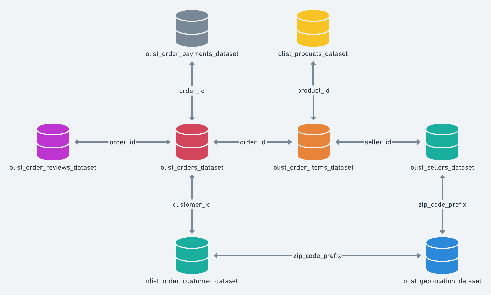

## About Dataset

# Brazilian E-Commerce Public Dataset by Olist

Welcome! This is a Brazilian ecommerce public dataset of orders made at [Olist Store](http://www.olist.com). The dataset has information of 100k orders from 2016 to 2018 made at multiple marketplaces in Brazil. Its features allows viewing an order from multiple dimensions: from order status, price, payment and freight performance to customer location, product attributes and finally reviews written by customers. We also released a geolocation dataset that relates Brazilian zip codes to lat/lng coordinates.

This is real commercial data, it has been anonymised, and references to the companies and partners in the review text have been replaced with the names of Game of Thrones great houses.

## Join it With the Marketing Funnel by Olist

We have also released a [Marketing Funnel Dataset](https://www.kaggle.com/olistbr/marketing-funnel-olist/home). You may join both datasets and see an order from Marketing perspective now!

**Instructions on joining are available on this [Kernel](https://www.kaggle.com/andresionek/joining-marketing-funnel-with-brazilian-e-commerce).**

## Context

This dataset was generously provided by Olist, the largest department store in Brazilian marketplaces. Olist connects small businesses from all over Brazil to channels without hassle and with a single contract. Those merchants are able to sell their products through the Olist Store and ship them directly to the customers using Olist logistics partners. See more on our website: [www.olist.com](https://www.olist.com)

After a customer purchases the product from Olist Store a seller gets notified to fulfill that order. Once the customer receives the product, or the estimated delivery date is due, the customer gets a satisfaction survey by email where he can give a note for the purchase experience and write down some comments.

### Attention

1. An order might have multiple items.
2. Each item might be fulfilled by a distinct seller.
3. All text identifying stores and partners where replaced by the names of Game of Thrones great houses.

### Example of a product listing on a marketplace

## Data Schema

The data is divided in multiple datasets for better understanding and organization. Please refer to the following data schema when working with it:  

## Classified Dataset

We had previously released a classified dataset, but we removed it at *Version 6*. We intend to release it again as a new dataset with a new data schema. While we don't finish it, you may use the classified dataset available at the *Version 5* or previous.

## Inspiration

Here are some inspiration for possible outcomes from this dataset.

**NLP:**  
  
This dataset offers a supreme environment to parse out the reviews text through its multiple dimensions.

**Clustering:**  
  
Some customers didn't write a review. But why are they happy or mad?

**Sales Prediction:**  
  
With purchase date information you'll be able to predict future sales.

**Delivery Performance:**  
  
You will also be able to work through delivery performance and find ways to optimize delivery times.

**Product Quality:**  
  
Enjoy yourself discovering the products categories that are more prone to customer insatisfaction.

**Feature Engineering:**  
  
Create features from this rich dataset or attach some external public information to it.

## Acknowledgements

Thanks to Olist for releasing this dataset.\

# Data explorer

# Customers Dataset
This dataset has information about the customer and its location. Use it to identify unique customers in the orders dataset and to find the orders delivery location.

At our system each order is assigned to a unique customer_id. This means that the same customer will get different ids for different orders. The purpose of having a customer_unique_id on the dataset is to allow you to identify customers that made repurchases at the store. Otherwise you would find that each order had a different customer associated with.

Please refer to the data schema: Data Schema

# Geolocation Dataset
This dataset has information Brazilian zip codes and its lat/lng coordinates. Use it to plot maps and find distances between sellers and customers.

Please refer to the data schema: Data Schema

# Order Items Dataset
This dataset includes data about the items purchased within each order.

**Example:**

The order_id = `00143d0f86d6fbd9f9b38ab440ac16f5` has 3 items (same product). Each item has the freight calculated accordingly to its measures and weight. To get the total freight value for each order you just have to sum.

The total order_item value is: `21.33 * 3 = 63.99`
The total freight value is: `15.10 * 3 = 45.30`
The total order value (product + freight) is: `45.30 + 63.99 = 109.29`

Please refer to the data schema.

# Order Payments Dataset
This dataset includes data about the orders payment options.

A customer may pay an order with more than one payment method (e.g. two vouchers, or a voucher plus a credit card). If so, a `payment_sequential` is created to accommodate all payments. Payment types include credit card, boleto (Brazilian bank slip), voucher, and debit card, and `payment_installments` records how many installments the customer chose.

Please refer to the data schema.

# Order Reviews Dataset
This dataset includes data about the reviews made by the customers.

After a customer purchases the product from Olist Store a seller gets notified to fulfill that order. Once the customer receives the product, or the estimated delivery date is due, the customer gets a satisfaction survey by email where he can give a note for the purchase experience (`review_score`, 1-5) and write down some comments (`review_comment_title` / `review_comment_message`, in Portuguese).

Please refer to the data schema.

# Orders Dataset
This is the core dataset. From each order you might find all other information.

Please refer to the data schema.

# Products Dataset
This dataset includes data about the products sold by Olist.

Please refer to the data schema.

# Sellers Dataset
This dataset includes data about the sellers that fulfilled orders made at Olist. Use it to find the seller location and to identify which seller fulfilled each product.

Please refer to the data schema.

# Product Category Name Translation Dataset
Translates the `product_category_name` to English.

